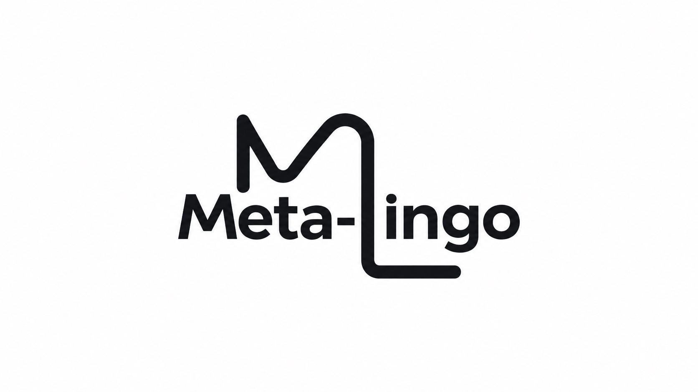
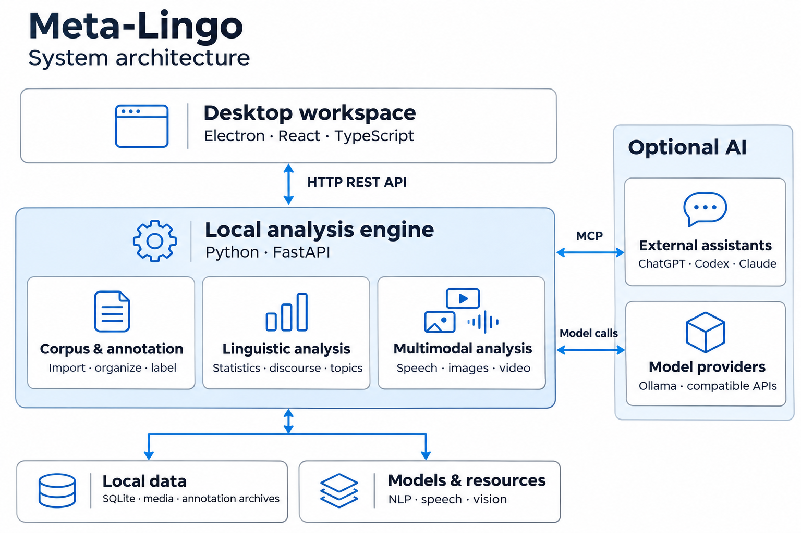

  

<h1 align="center">Meta-Lingo</h1>

  <strong>A Modern Multimodal Corpus Research Software</strong>

  <a href="#features">Features</a> |
  <a href="#installation">Installation</a> |
  <a href="#quick-start">Quick Start</a> |
  <a href="#documentation">Documentation</a> |
  <a href="#license">License</a>

  
  
  
  

  
  
  
  
  

***

## Overview

**Meta-Lingo** is a comprehensive desktop application designed for corpus linguistics research. Built with modern technologies (Electron + React + Python FastAPI), it provides powerful tools for multimodal corpus management, linguistic analysis, and annotation.

  

## Features

### Corpus Management

- **Multimodal Support**: Text, PDF, audio, and video files with drag-and-drop upload
- **Audio Transcription**: Whisper Large V3 Turbo for supported languages, with editable time-aligned transcripts
- **Forced Alignment**: Wav2Vec2 word-level alignment for English audio (automatic)
- **Pitch Extraction**: TorchCrepe F0 extraction for English audio (automatic)
- **Video Analysis**: YOLOv8 object detection and CLIP semantic classification
- **Automatic Annotation**: SpaCy NLP (POS/NER/Dependency), USAS semantic domains, MIPVU metaphor identification
- **Metadata Management**: Language, author, source, text type with tag system

### Analysis Tools

| Module                 | Description                                                                                                                                                                                            |
| ---------------------- | ------------------------------------------------------------------------------------------------------------------------------------------------------------------------------------------------------ |
| **Word Frequency**     | Frequency analysis with POS filtering, lemma/word form selection, visualization                                                                                                                        |
| **N-gram Analysis**    | 2-6 gram support, nested grouping, Sankey diagrams                                                                                                                                                     |
| **Keyword Extraction** | TF-IDF, TextRank, YAKE!, RAKE, and 9 keyness statistics methods                                                                                                                                        |
| **Concordance**        | KWIC search modes, CQL query language and visual CQL Builder                                                                                                                                          |
| **Synonym Analysis**   | WordNet integration with network visualization                                                                                                                                                         |
| **Semantic Domain**    | USAS-based analysis with dual view (by domain/by word)                                                                                                                                                 |
| **Sentiment Analysis** | NRC-EmoLex polarity + emotion dimension analysis (pie/radar)                                                                                                                                           |
| **Metaphor Analysis**  | MIPVU-based indirect, direct and implicit metaphor identification, with separate indirect/direct models and contextual annotation                                                                       |
| **Multidimensional Analysis** | Biber linguistic features and six dimensions; includes an adaptation of Andrea Nini's MAT with retained GPLv3 notices                                                                                 |
| **Collocation Analysis / Word Sketch** | Window-based statistics, grammatical relations, logDice scoring and difference comparison                                                                                                  |
| **Topic Modeling**     | BERTopic, LDA, LSA, NMF with dynamic topic analysis                                                                                                                                                    |
| **Bibliography**       | Refworks parsing (WOS/CNKI), shadow corpus for abstracts, network visualization, burst detection; analysis modules support corpus/literature toggle and library selection (all / by keyword / manual). |

### Annotation Mode

- **Text Annotation**: Sentence-level display, intelligent segmentation, batch annotation
- **Multimodal Annotation**: Time-aligned transcripts, manual video boxes, keyframe sequences, audio intervals and visual timelines
- **Audio Waveform Annotation**: Waveform selection and manual annotation; English audio additionally supports automatic word alignment and pitch overlays
- **Framework Management**: Built-in linguistic frameworks, custom label hierarchies and annotation relations
- **Annotation Archives**: Export/import manual annotations with sequence timing and spatial coordinates for review, backup and downstream data conversion
- **Inter-coder Reliability**: Fleiss' Kappa, Cohen's Kappa, Krippendorff's Alpha, Gold Standard support (plain text archives only)
- **Syntax Visualization**: Constituency and dependency parsing

### Additional Features

- **Dictionary Lookup**: User-imported MDX/MDD dictionaries with unified lookup and companion resources
- **Bilingual Interface**: Chinese and English with real-time switching
- **Custom Wallpaper**: Personalized application background
- **Export Options**: Corpus bundles, annotation archives, and CSV/PNG/SVG exports where supported
- **Lemy Desktop Companion**: A draggable companion with task status, conversation shortcuts and customizable movement
- **User Resources**: Import NRC lexicons, MDX dictionaries with companion assets, and validated reference-frequency CSVs
- **AI Assistant (optional)**: context-aware assistant for analysis modules (Ollama or OpenAI-compatible API)
- **MCP Server Integration (optional)**: connect Claude Desktop, compatible ChatGPT/Codex desktop clients with local-plugin support, or other MCP clients to Meta-Lingo's research tools
- **OpenAI-Compatible API Support (optional)**: configure compatible endpoints/keys for AI-assisted features and better model naming

## System Architecture

  

The desktop workspace connects to a local FastAPI engine. Corpora, media and annotation archives are stored locally. Optional AI connections support research workflows through MCP, Ollama or a configured compatible API.

## Tech Stack

### Frontend

| Technology    | Purpose                       |
| ------------- | ----------------------------- |
| Electron 28+  | Desktop application framework |
| React 18      | UI framework                  |
| TypeScript 5  | Type safety                   |
| Material-UI 5 | Component library             |
| D3.js 7       | Data visualization            |
| Plotly.js     | Interactive charts            |

### Backend

| Technology   | Purpose             |
| ------------ | ------------------- |
| Python 3.12  | Runtime environment |
| FastAPI      | Web framework       |
| SpaCy 3.8+   | NLP processing      |
| PyMUSAS      | Semantic tagging    |
| BERTopic     | Topic modeling      |
| Transformers | Whisper/CLIP models |
| Ultralytics  | YOLOv8              |

## Installation

### Download

Visit our official website to download the latest version:

**<https://tltanium.github.io/meta-lingo-website/>**

For a ready-to-use application, choose the official distribution above. Dependencies and source-build instructions are documented in [SOURCE.md](SOURCE.md); use and modification are governed by [LICENSE](LICENSE).

## Quick Start

After installing from the website, launch the application and follow the in-app guidance. For documentation, use the Help module inside the application.

## Documentation

- **In-app Help**: Access via the Help module with bilingual documentation
- **API Documentation**: <http://localhost:8000/docs> (when backend is running)

## API Overview

| Category       | Endpoints                                                  |
| -------------- | ---------------------------------------------------------- |
| Corpus         | `/api/corpus/*` - CRUD, upload, annotation                 |
| Analysis       | `/api/analysis/*` - Word frequency, N-gram, keywords, etc. |
| Collocation    | `/api/collocation/*` - KWIC search, CQL parsing            |
| Topic Modeling | `/api/topic-modeling/*` - BERTopic, LDA, LSA, NMF          |
| Annotation     | `/api/annotation/*`, `/api/framework/*`                    |
| Word Sketch    | `/api/sketch/*` - Grammar patterns, difference             |
| Bibliography   | `/api/biblio/*` - Libraries, visualization                 |

Full API documentation available at `/docs` endpoint.

## Models & Resources

Meta-Lingo integrates several pre-trained models:

| Model                      | Purpose                                 | Source                                                                                                       |
| -------------------------- | --------------------------------------- | ------------------------------------------------------------------------------------------------------------ |
| Whisper Large V3 Turbo     | Audio transcription                     | OpenAI                                                                                                       |
| Wav2Vec2-base-960h         | Forced alignment (English)              | [ModelScope — facebook/wav2vec2-base-960h](https://modelscope.cn/models/facebook/wav2vec2-base-960h/summary) |
| TorchCrepe Full            | Pitch extraction (F0)                   | [maxrmorrison/torchcrepe](https://github.com/maxrmorrison/torchcrepe)                                        |
| YOLOv8                     | Object detection                        | Ultralytics                                                                                                  |
| CLIP ViT-Large-Patch14     | Image classification                    | OpenAI                                                                                                       |
| SpaCy en/zh\_core\_web\_sm | NLP processing (no static word vectors) | Explosion                                                                                                    |
| metalingo-indirect-metaphor | MIPVU indirect metaphor detection (F1 82.29) | [TommyLeo](https://www.modelscope.cn/models/TommyLeo/metalingo-indirect-metaphor)                       |
| metalingo-direct-metaphor  | MIPVU direct metaphor / mflag detection (F1 76.52) | [TommyLeo](https://www.modelscope.cn/models/TommyLeo/metalingo-direct-metaphor)                  |
| Sentence-BERT              | Text embeddings                         | sentence-transformers                                                                                        |

## Contributing

This project is currently maintained for academic research purposes. For bug reports or feature requests, please open an issue.

## Changelog

### v4.9.74 — Desktop experience and multimodal workflows (2026-11-07)

This release brings together the v4.9.52–v4.9.74 updates.

- **Lemy desktop companion**: keep Agent and corpus-processing tasks in view, return to conversations or corpora, and personalize a draggable companion with optional roaming and always-on-top behavior.
- **Startup and recovery**: a clean, theme-aware brand screen leads into the workspace. If startup fails, a confirmed full-app restart preserves existing research data and settings.
- **Complete manual annotation archives**: audio sequences and video-box keyframes retain timing, positions and per-frame edits when saved and exported, providing structured material for downstream format conversion.
- **User-imported resources**: add NRC lexicons, MDX dictionaries with MDD/CSS/media companions, and validated reference-frequency CSVs in Settings. Reference cards use one set of names, groups, tags and descriptions across interface languages; counts and sizes are calculated automatically.
- **Multilingual workflows**: annotation links preserve surface words when a lemma is unavailable, including Chinese transcript searches; Unicode media filenames play correctly in corpus previews.
- **AI and MCP**: private local MCP + Skill setup for compatible ChatGPT/Codex desktop clients, Claude Desktop extensions, and resource-aware analysis that checks available dictionaries and reference corpora.
- **Resource management and reset**: searchable imported-resource lists, consistent removal controls, and broader factory reset of local imports, preferences and Lemy state. Original imported source files remain untouched.
- **Licensing and attribution**: original code is AGPL-3.0-only, with in-app third-party notices and documented corresponding-source access. MAT-derived MDA code retains its GPLv3 notices and Andrea Nini attribution.

Selected earlier milestones

#### v4.9.52–v4.9.58

- Reference-corpus keyness uses top-1 token counts; word-form, lemma and semantic-domain comparisons share consistent frequency accounting.
- Settings gained user-imported NRC, dictionaries and reference CSVs, alongside resource discovery for AI/MCP workflows.
- AGPL licensing and MAT/MDA source provenance are documented in [LICENSING.md](LICENSING.md), [third-party notices](THIRD_PARTY_NOTICES.md) and the [MAT notice](third-party-licenses/MAT-NOTICE.md).

#### v4.8.x — May–June 2026

- Introduced the current indirect and direct MIPVU model families.
- Added regex exclusion filters across corpus-analysis modules and improved annotation-progress reporting.

Earlier entries are summarized here; detailed changes remain available in the [repository history](https://github.com/TLtanium/meta-lingo-electron/commits/master/).

## License

**GNU Affero General Public License v3.0 (AGPL-3.0-only)**

Copyright © 2026 Tommy Leo. Original Meta-Lingo code may be used, modified and
redistributed, including commercially, under AGPLv3. Preserve notices and meet
its corresponding-source and network-use obligations. No warranty is provided.

The author also grants AGPL-3.0-only permission for copyright-controlled original
code in earlier released versions, effective 2026-11-06. See the precise scope in
[LICENSING.md](LICENSING.md). This does not relicense third-party content or cure
earlier third-party permission issues.

See the single official [LICENSE](LICENSE),
[third-party notices](THIRD_PARTY_NOTICES.md) and [source/build instructions](SOURCE.md).
Third-party components, optional models and user data retain their own terms.
NRC, dictionaries and reference CSVs are not bundled; import authorized resources
through **Settings → User resources**. See the bilingual Help for complete steps.

***

  <strong>Copyright 2026 Tommy Leo · AGPL-3.0-only</strong>

